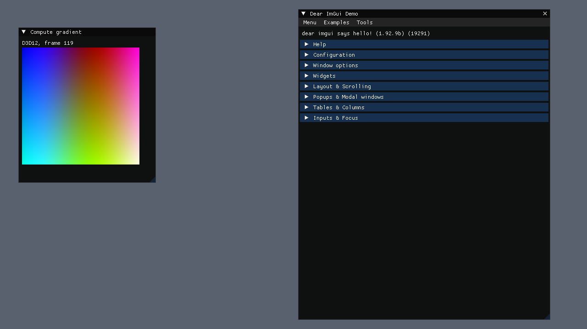
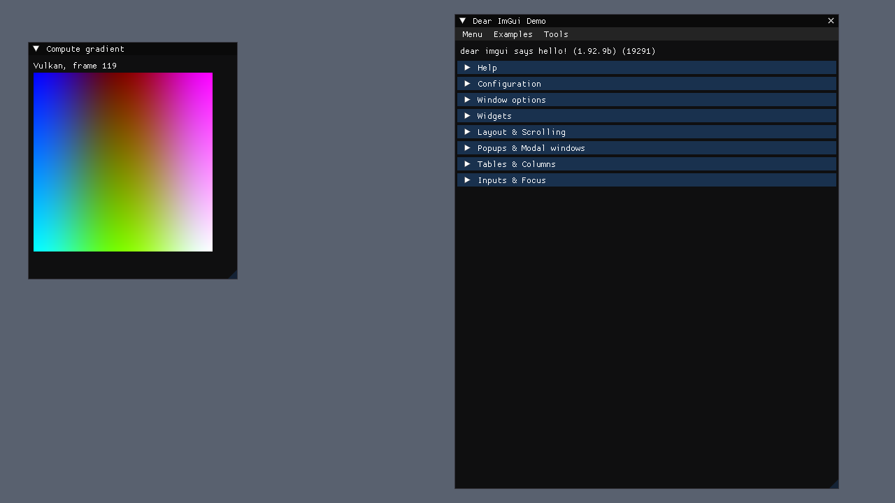
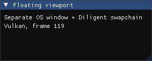

# Spike: Diligent + SDL3 + Dear ImGui (P0.3)

**Question:** can forge3d build its RHI on Diligent Engine, with SDL3 windows and a docking Dear ImGui editor, on both D3D12 and Vulkan?

**Recommendation: GO.** Everything the plan needs from Diligent worked on both backends on the first real try. The gaps found are small and have known workarounds (below). Diligent stays isolated in `f3d_render_rhi` as planned, so the cost of a later switch stays bounded.

Code: [`spikes/diligent/main.cpp`](../../spikes/diligent/main.cpp), built only with `-DF3D_BUILD_SPIKES=ON`. Fetch logic shared with the product build: [`cmake/F3DDiligent.cmake`](../../cmake/F3DDiligent.cmake).

```sh
tools\vsenv.cmd cmake --preset win-msvc -B build/win-msvc-spikes -DF3D_BUILD_SPIKES=ON
tools\vsenv.cmd cmake --build build/win-msvc-spikes --config Debug --target forge3d-spike-diligent
build\win-msvc-spikes\bin\Debug\forge3d-spike-diligent --rhi=d3d12|vulkan [--frames N] [--hidden]
    [--capture out.png] [--no-viewports] [--no-vsync] [--validation]
```

## Test machine

Windows 11 laptop with **hybrid graphics**: AMD Radeon integrated GPU (495 MB carve-out) + NVIDIA GeForce RTX 3050 Laptop GPU. MSVC 19.50 (VS 2026), Debug and Release builds.

## Results

| Check | D3D12 | Vulkan |
|---|---|---|
| Device + swapchain from an SDL3 native window (`SDL_PROP_WINDOW_WIN32_HWND_POINTER`) | ✅ | ✅ |
| Clear colour, resize (`SDL_EVENT_WINDOW_PIXEL_SIZE_CHANGED` → `ISwapChain::Resize`) | ✅ | ✅ |
| Hidden window (`SDL_WINDOW_HIDDEN`) renders and presents normally | ✅ | ✅ |
| ImGui (vcpkg imgui 1.92.9 docking) through Diligent's ImGui renderer | ✅ | ✅ |
| Docking (`DockSpaceOverViewport`) | ✅ | ✅ |
| Multi-viewport (ImGui window in its own OS window) | ✅ with our hooks | ✅ with our hooks |
| Compute shader (HLSL) writing a UAV texture, shown with `ImGui::Image` | ✅ | ✅ |
| Backbuffer readback → PNG (`--capture`) | ✅ | ✅ |
| `--frames 120 --hidden` exits 0 (ctest `integration.spike.diligent.{d3d12,vulkan}`) | ✅ | ✅ |
| D3D12 debug layer (`--validation`): no errors reported | ✅ | n/a (Khronos validation layer not installed) |

Captures (120th frame, hidden window):

| D3D12 main window | Vulkan main window | Vulkan secondary viewport |
|---|---|---|
|  |  |  |

## Device capabilities found

| | D3D12 (picked the **AMD iGPU**) | Vulkan (picked the **RTX 3050**) |
|---|---|---|
| API | 12.1, max shader model 6.7 | 1.4.325 |
| Compute | yes | yes |
| Bindless resources | yes | yes |
| Ray tracing | **no** | yes: pipelines, inline (RayQuery), indirect; max recursion 31 |
| Mesh shaders | no | yes |
| Wave ops / FP16 | yes / yes | yes / yes |
| BC7 | yes | yes |

The ray-tracing result is a property of the adapter, not the backend: Diligent's D3D12 backend takes the first adapter (the iGPU), and its Vulkan backend prefers a discrete GPU. This matches the design: RT is an accelerator, never a requirement. The iGPU path (no RT) is our reference target anyway.

## Performance notes

- Debug and Release, 120 frames, vsync on, both backends: **7–8 ms/frame**. With `--no-vsync`: **~0.9 ms/frame** on both, so the frame is entirely present-bound.
- The first Vulkan runs showed **33 ms per FIFO present** (67 ms/frame with a second viewport swapchain). Re-running a few minutes later gave 7.7 ms/frame with vsync, so this did not reproduce. It is most likely a dGPU power-state or hybrid-display transient (the RTX 3050 presents through the iGPU's display). P1.1 should measure presents with Tracy before drawing conclusions.
- Release spike executable (D3D12 + Vulkan + glslang + SPIRV-Tools, all static): **8.7 MB**, plus SDL3/spdlog/fmt DLLs (~2.9 MB). This fits the 60 MB install budget comfortably.
- Diligent fetch: ~480 MB of source with submodules. Full Diligent build: ~690 objects, ~4.5 min Release on this laptop (one-time, cached by Ninja afterwards).

## API gaps and workarounds

1. **No vcpkg port.** Diligent is fetched with `FetchContent` at pinned commits (user decision, recorded in the progress log). We build only DiligentCore with the D3D12 and Vulkan backends. OpenGL, D3D11, Metal, WebGPU, archiver and render-state packager are disabled.
2. **The last release tag is too old.** v2.5.6 (2024-09) uses `ImDrawCmd::TextureId`, which imgui 1.92 removed. Master as of 2026-10-14 supports 1.92's texture API (`ImGuiBackendFlags_RendererHasTextures`). Pinned **commits** instead: DiligentCore `199d9f3c`, DiligentTools `858b0380`.
3. **One imgui in the build.** We don't build DiligentTools (it would bundle its own imgui, zlib, libpng and more). `cmake/F3DDiligent.cmake` compiles only `ImGuiDiligentRenderer.cpp` and `ImGuiImplDiligent.cpp` against vcpkg's imgui. DiligentTools' headers include `../../../DiligentCore/...`, so both repos must be fetched as siblings with exactly those names.
4. **Platform backend.** Diligent's own ImGui platform backends are Win32/X11-specific. We use vcpkg imgui's `imgui_impl_sdl3` (`InitForOther`) and get input, DPI and multi-viewport platform windows for free.
5. **Multi-viewport is not implemented by Diligent's renderer.** We added the `Renderer_CreateWindow / DestroyWindow / SetWindowSize / RenderWindow / SwapBuffers` hooks (~70 lines): one Diligent swapchain per ImGui platform window. Its `RenderDrawData` takes the target size from `NewFrame()`, so we switch it per viewport and restore it. That works, but it relies on internal behaviour. **P1.2 should own this code in the RHI wrapper** (or use a small ImGui renderer of our own on the RHI, ~400 lines).
6. **Windows MAX_PATH.** SPIRV-Cross test files exceed 260 characters during the submodule checkout. Fixed by setting `core.longpaths` through `GIT_CONFIG_*` environment variables during configure (no change to the user's git config).
7. **Storage-image format on Vulkan.** glslang's HLSL front end gives an untyped `RWTexture2D<float4>` the `rgba32f` format, so the spike's UAV texture is `RGBA32_FLOAT`. For other formats we need `[[vk::image_format("rgba8")]]` annotations, or DXC for SPIR-V. Decide this with the shader pipeline in P1.1 (DXC is planned anyway).
8. **Linux window handle.** Diligent's `LinuxNativeWindow` needs an X11 window ID, so the spike forces SDL's x11 driver on Linux (XWayland on Wayland desktops). Native Wayland surfaces need checking in P1.1. Linux was not run here.
9. **Log noise.** Diligent writes info-level messages to stdout. P1.1 should route Diligent's message callback (`SetDebugMessageCallback`) into `f3d::core` logging.

## Follow-ups for P1.1

- An adapter-selection policy plus an `--adapter` option. Log the chosen adapter. On hybrid laptops, prefer what the user configured. The default should be deliberate, not "first adapter".
- Route Diligent messages into spdlog, and suppress per-frame info spam.
- Capture readback is in the spike (`capture_backbuffer`) and moves into `rhi::Swapchain` almost as is.
- Measure present timing with Tracy on both backends (see the transient above).

## Not covered (needs the user or other hardware)

- `[human]` Go/no-go confirmation.
- Linux / X11 / lavapipe runs.
- Interactive undocking with a mouse. Multi-viewport rendering was verified with a programmatically placed window and its swapchain capture; dragging windows across monitors was not tried.
